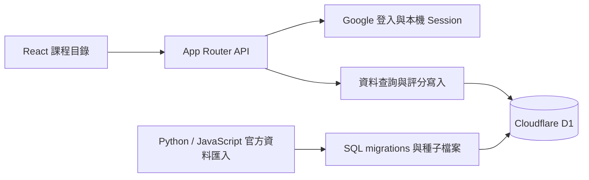

# WZCR 程式架構

WZCR 是課程查詢與評分網站。React 負責畫面，Next.js App Router 的路由介面由 vinext/Vite 建置，正式執行環境是 Cloudflare Workers，資料存於 D1。這是一個前後端同庫的應用程式。

## 程式入口與分工

| 層 | 主要檔案 | 職責 |
| --- | --- | --- |
| 網頁入口 | `app/page.tsx`、`app/courses/page.tsx` | 首頁轉往課程目錄，載入互動元件 |
| 互動畫面 | `app/courses/course-directory.tsx` | 學校、系所、學期、搜尋、分頁、評分與新增課程；請求版本避免舊查詢覆蓋新結果 |
| HTTP API | `app/api/courses/`、`app/api/departments/`、`app/api/universities/` | 驗證請求、登入、來源與頻率，回傳 JSON |
| 登入 | `app/auth/server.ts`、`app/api/auth/google/` | OAuth state、PKCE、Google ID token 驗證、HttpOnly session cookie |
| 資料存取 | `db/courses.ts`、`db/departments.ts`、`db/rate-limit.ts` | D1 參數化 SQL、彙整分數、系所清單及限制頻率 |
| 資料定義與初始化 | `db/schema.ts`、`db/index.ts` | Drizzle schema、D1 綁定、版本檢查與必要的相容升級；API 主要使用直接 D1 SQL |
| 離線資料流程 | `scripts/`、`drizzle/` | 從校方公開來源整理課表與師資，產生可重跑的種子檔案和 migration |

## 一張評分卡是「課程＋授課教師」

`courses` 存課程；`course_instructors` 存該課程的老師；`course_ratings` 按使用者、課程、老師保存五項評分。因此 API 的 `id` 是評分卡識別碼，`courseId` 才是資料庫的課程識別碼。同一課程不同老師會各有一張卡。

查詢：畫面建立篩選參數 → API 驗證 → D1 聯結課程、老師、評分 → 按老師分組計算平均 → 回傳卡片與下一頁位置。

評分：確認同來源與登入 → 限制頻率 → 驗證五項 0–100 整數 → 確認課程與老師存在 → UPSERT 使用者評分 → 回傳更新後的卡片。同一人重新評分會更新原紀錄。

登入：Google 回傳驗證碼 → 驗證 state 並使用 PKCE 換取 token → 驗證 Google ID token → 建立站內帳號與 session；D1 保存的是 session token 的雜湊。

## 驗證與邊界

執行 `npm test`、`npm run lint`、`npm run build`。測試前會產生師資 SQL 種子檔案。公開副本沒有原站密鑰、帳號或評分資料；本次整理沒有部署或修改原站資料庫。
